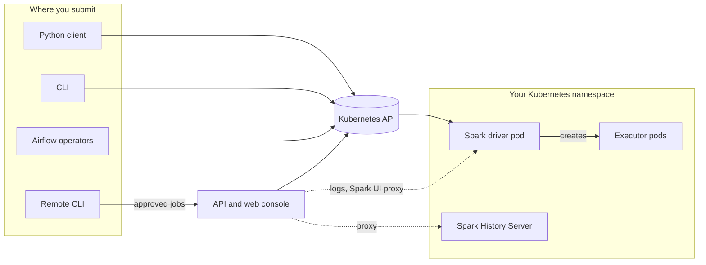

# Spark on Kubernetes

Submit and observe Spark applications from Python, the CLI or Airflow using your
existing Kubernetes cluster. Optional API and shared web-console components make
applications, logs and diagnostics accessible to operators. Spark creates the
executors; your cluster and applications retain their infrastructure and data
responsibilities.

!!! tip "What's new"

    The [release notes](https://hussein.awala.fr/spark-on-k8s/release-notes/) list
    every published release and the release in preparation, whichever documentation
    version you are reading.

[Start here](user-guide/start-here.md){ .md-button .md-button--primary }
[Install](user-guide/installation.md){ .md-button }

You can use the core Python client or CLI without deploying the API or Airflow.
Spark and Java run in the application image; they are not required on the submitting
machine. See [Spark compatibility](user-guide/spark_compatibility.md) for image requirements.

## Choose what to run

-   :material-rocket-launch:{ .lg .middle } **Submit an application**

    ---

    Run an existing Python or JVM application from the Python client or the CLI,
    then wait for it, stream its logs or cancel it.

    [:octicons-arrow-right-24: Your first Kubernetes job](user-guide/getting_started.md)

-   :material-file-document-check:{ .lg .middle } **Portable job files and SQL**

    ---

    Describe jobs in versioned files with profiles, preview them offline, and run
    SQL files or inline statements.

    [:octicons-arrow-right-24: Job files](user-guide/jobs.md) ·
    [SQL jobs](user-guide/sql.md)

-   :material-lan-connect:{ .lg .middle } **Spark Connect and notebooks**

    ---

    Use an existing Spark Connect endpoint, or create a private server for a
    notebook or interactive session.

    [:octicons-arrow-right-24: Spark Connect](user-guide/spark_connect.md) ·
    [Jupyter](user-guide/jupyter.md)

-   :material-weather-windy:{ .lg .middle } **Schedule with Airflow**

    ---

    Run Spark applications and SQL from Airflow 2.11 or 3, with deferrable
    waiting and a native Airflow 3 task tab.

    [:octicons-arrow-right-24: Airflow](user-guide/airflow.md)

-   :material-monitor-dashboard:{ .lg .middle } **Observe and diagnose**

    ---

    List applications, read logs and open the Spark UI from the web console, and
    explain Pending or failed drivers.

    [:octicons-arrow-right-24: Diagnostics](user-guide/diagnostics.md) ·
    [Run history](user-guide/run-history.md)

-   :material-ship-wheel:{ .lg .middle } **Deploy the API**

    ---

    Install the API, console and optional History Server with the Helm chart,
    and accept approved remote submissions.

    [:octicons-arrow-right-24: Chart deployment](user-guide/chart-deployments.md) ·
    [Remote submission](user-guide/remote-submission.md)

Try the [ETL starter locally](user-guide/starters.md#order-events-to-parquet) before
configuring a cluster, or run dbt with temporary Spark compute through the
[experimental dbt adapter](user-guide/dbt.md).

## How the pieces fit

Every route creates the driver pod through the Kubernetes API, and Spark then
creates and owns the executors. Local routes use your Kubernetes credentials;
remote submission uses the API's service account after its policy admits the job.
The API is optional: it adds a browser console, proxies and policy-gated remote
submission on top of the same client.

## Before you rely on it

The **develop** documentation follows `main`. Before copying its examples,
choose [a matching published release or a source installation](user-guide/installation.md).
Installing the PyPI package does not include the repository's example files.
Chart and package releases are independent. Read [support boundaries](user-guide/support.md) before planning
production operation: this project does not provide a multi-tenant scheduler,
a highly available metadata service or an embedded identity provider.

Contributors can use the [repository map and check routes](development.md).
Maintainers use the [release runbook](releases.md) to qualify and publish artifacts.
