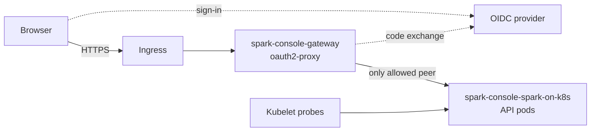

# Single sign-on gateway

The API does not authenticate users. Put an authenticating gateway in front of the
console before anyone outside the cluster administrators can reach it. This recipe
uses [oauth2-proxy](https://oauth2-proxy.github.io/oauth2-proxy/) with any OpenID
Connect provider, in front of the Helm chart's API Service. The manifests are in
[`examples/sso-gateway`](https://github.com/hussein-awala/spark-on-k8s/tree/main/examples/sso-gateway).

## What the gateway does and does not provide

The gateway decides **who reaches the console**: only users who sign in with your
provider, have an email address in the allowed domain and belong to the allowed
group get a session. That session admits them to every console surface: pages,
static assets, JSON routes, Spark UI and History proxies and log streams.

It does **not** authorize individual actions inside the API. The API never learns
who is signed in. Every admitted user can do everything the console offers, with
the API's single Kubernetes service account: list applications, read logs, open
Spark UIs and, unless that account is read-only (`readOnly: true`, the chart
default), kill or delete drivers. Hiding the console's kill and delete buttons
does not remove those routes. Kubernetes audit logs attribute those actions to the
API service account; only the gateway's request log records the signed-in user.
Use separate releases, service accounts and groups for separate trust boundaries;
see [operational boundaries](operations.md#know-which-identity-is-acting). The
gateway also does not isolate Spark or History HTML from the console origin; see
[browser and gateway boundaries](../security-boundaries.md).

## Layout



| File | Contents |
| --- | --- |
| `console-values.yaml` | Chart overlay for release `spark-console`: ClusterIP Service, chart Ingress disabled, public WebSocket origin |
| `gateway.yaml` | oauth2-proxy ConfigMap, Deployment, Service and Ingress |
| `network-policy.yaml` | Admits only gateway pods to the API pods |

??? example "console-values.yaml"

    ```yaml
    --8<-- "examples/sso-gateway/console-values.yaml"
    ```

??? example "gateway.yaml"

    ```yaml
    --8<-- "examples/sso-gateway/gateway.yaml"
    ```

??? example "network-policy.yaml"

    ```yaml
    --8<-- "examples/sso-gateway/network-policy.yaml"
    ```

oauth2-proxy runs as a **separate Deployment**, not as a sidecar in the API pod.
The chart has no sidecar setting, and its Service and kubelet probes target the
API container port directly. A sidecar would have to make the API listen only on
loopback, which breaks the chart's HTTP probes, or leave the API port open beside
it. A separate Deployment keeps the chart unchanged, rolls out and scales
independently, and makes the boundary explicit through the NetworkPolicy. Cookie
sessions keep no server-side state, so gateway replicas share only their Secret.

## Deploy

You need an OIDC client registered as a confidential web application with the
redirect URI `https://spark.example.com/oauth2/callback`, a provider that releases
group membership in the ID token's `groups` claim, an ingress controller with a
TLS certificate in the `spark-console-tls` Secret, and a network plugin that
enforces NetworkPolicy. Replace `spark.example.com`, the issuer, client ID, email
domain and group in the example files before applying them.

1. Install the API release. Add your image and access values as described in
   [chart deployment boundaries](chart-deployments.md); Helm replaces lists, so
   merge any `env` entries of your own into one list.

    ```bash
    : "${API_IMAGE_DIGEST:?Set the verified API image digest}"
    helm upgrade --install spark-console ./chart --namespace spark-system --create-namespace \
      -f examples/sso-gateway/console-values.yaml \
      --set-string image.digest="$API_IMAGE_DIGEST"
    ```

2. Restrict connections to the API pods:

    ```bash
    kubectl apply --namespace spark-system -f examples/sso-gateway/network-policy.yaml
    ```

3. Create the gateway Secret from your environment. Never commit either value.

    ```bash
    : "${OIDC_CLIENT_SECRET:?Set the client secret issued by your provider}"
    kubectl create secret generic spark-console-gateway --namespace spark-system \
      --from-literal=client-secret="$OIDC_CLIENT_SECRET" \
      --from-literal=cookie-secret="$(python3 -c 'import base64, os; print(base64.urlsafe_b64encode(os.urandom(32)).decode())')"
    ```

4. Deploy the gateway and wait for it:

    ```bash
    kubectl apply --namespace spark-system -f examples/sso-gateway/gateway.yaml
    kubectl rollout status --namespace spark-system deployment/spark-console-gateway
    ```

Open `https://spark.example.com/webserver/apps`. The example pins
`quay.io/oauth2-proxy/oauth2-proxy:v7.15.6` by tag; deploy a digest you have
verified for that tag. oauth2-proxy labels the structured `alpha-config.yaml`
format alpha, so validate it with the new image before upgrading:
`oauth2-proxy --alpha-config alpha-config.yaml <your flags> --config-test`.

## Settings the console depends on

| Setting | Where | Reason |
| --- | --- | --- |
| `SPARK_ON_K8S_API_WEBSOCKET_ALLOWED_ORIGINS=https://spark.example.com` | Chart `env` | The gateway terminates TLS, so the API's direct Host/scheme comparison cannot match the browser origin and would reject log streams. Use the exact origin without a path. See [log WebSocket origins](../security-boundaries.md#log-websocket-browser-origins). |
| One upstream for `/` with `proxyWebSockets: true` | `alpha-config.yaml` | Pages, `/static` assets, `/webserver/ui/...` proxies, JSON routes and the `/webserver/ws/logs/...` upgrade all pass through one authenticated route. |
| `--redirect-url` | Gateway args | The absolute public callback; it must equal the URI registered with the provider. |
| `--ping-path=/health`, `--ready-path=/ready` | Gateway args | oauth2-proxy answers these paths itself, without authentication, before routing. The API's own probe endpoints are therefore never proxied; the kubelet probes the API pod directly. |
| `--api-route` for `/app`, `/apps`, `/runs/v1`, `/webserver/api` and `/webserver/ws` | Gateway args | After a session expires, background console requests and log streams receive 401 instead of a login redirect that browsers block across origins. Reload the page to sign in again. |
| `--email-domain` and `allowedGroups` | Args and provider | A user must satisfy both. Add the scope your provider uses to release groups if `openid email profile` is not enough. |
| `code_challenge_method: S256`, `insecureSkipNonce: false` | Provider | Use PKCE and verify the ID token nonce. |
| `__Host-` cookie name, `--cookie-secure`, `--cookie-samesite=lax` | Gateway args | The session cookie is host-only, HTTPS-only and HttpOnly (the default). `Lax` cookies, including oauth2-proxy's sign-in CSRF cookie, are still sent on the top-level return from the provider; `Strict` breaks that return. `Lax` withholds the session from cross-site subrequests and form posts. The kill and delete routes use `PATCH` and `DELETE`, which another origin can send only after a CORS preflight that the API does not approve. |
| `--cookie-expire=8h`, `--session-cookie-minimal=true` | Gateway args | The cookie holds no provider tokens and is not refreshed. A user removed from the group keeps access until the session expires; shorten the lifetime for faster revocation. |

The example leaves `--reverse-proxy` disabled, so oauth2-proxy does not use
client-supplied `X-Forwarded-*` or `X-Real-IP` headers for its redirects or client
addresses; the absolute redirect URL makes them unnecessary. To log real client
addresses, enable it only together with `--trusted-proxy-ip` set to your ingress
controller's address ranges. Raise the ingress controller's read or idle timeout
if it closes quiet log streams; that setting is controller-specific.

## Identity headers are deliberately absent

The example defines no `injectRequestHeaders`, so oauth2-proxy sends no user,
email, group or token headers to the API. The API authorizes nothing per user. A
gateway-injected or client-forged `X-Forwarded-Email` therefore grants nothing, and
it cannot be used to add per-user rules later without changing the API.

The API reads one identity header only when `SPARK_ON_K8S_AUDIT_IDENTITY_HEADER`
names it, and then only copies it into [audit events](operations.md) as an
unverified claim. With this example a client can send that header itself, so leave
the variable unset, or have the gateway inject the header with
`injectRequestHeaders` so that it replaces any client-supplied value. An event
records no identity when the request carries the header more than once.

oauth2-proxy does not remove arbitrary client-supplied headers. That is acceptable
here because the Spark UI and History proxies forward only the documented
[request header allowlist](../security-boundaries.md#proxy-request-headers):
cookies, `Authorization` and identity headers from the browser or gateway never
reach Spark UIs. Log streams use the API's Kubernetes client. Do not place a
component that trusts identity headers behind this gateway unless oauth2-proxy sets
those headers itself, which replaces client-supplied values of the same name.

## Keep the API reachable only through the gateway

The NetworkPolicy selects the release's API pods with the chart's selector labels
and admits connections only from the gateway pods, on the API's `http` port. The
ingress controller and every other pod or namespace cannot connect to the API
Service. Kubernetes always allows connections from the pod's own node, which
carry the kubelet's `/health` and `/ready` probes, and `kubectl port-forward`
remains available to administrators.

The chart's `helm test` pod is not a gateway pod, so it cannot connect while the
policy applies. Other in-cluster callers need their own rule or a separate
release: a Prometheus scraper for `/metrics`, or the Airflow task UI through
`SPARK_ON_K8S_AIRFLOW_SERVICE_URL`. The policy has no effect unless the network
plugin enforces NetworkPolicy.

## Remote submission and automation

Keep remote submission disabled on this release, which is the chart default.
Run automation against a separate release with remote submission enabled, its own
service account and policy, and its own route that is not behind browser single
sign-on. The CLI authenticates there with the operator bearer token; see
[remote submission](remote-submission.md).

Enabling remote submission on the SSO release requires the operator token on every
request. The gateway would then have to discard each client's `Authorization`
header and inject the server token into every HTTP request and WebSocket upgrade,
which makes every admitted user an operator-token holder, and remote CLI clients
could no longer pass the gateway. This recipe does not cover that configuration.

## Serve the console below a path

To publish the console at `https://spark.example.com/platform/spark`, oauth2-proxy
removes the prefix before forwarding; the ingress must not. oauth2-proxy builds its
sign-in, callback and return URLs from the path it receives, so stripping the
prefix in front of it would send browsers outside the prefix. Change the example
as follows and register the new callback with your provider. The WebSocket origin
setting does not change: an origin has no path.

```yaml
# console-values.yaml: add to env
- name: SPARK_ON_K8S_API_ROOT_PATH
  value: /platform/spark
```

```yaml
# gateway.yaml, alpha-config.yaml upstream
- id: spark-console
  path: ^/platform/spark/(.*)$
  rewriteTarget: /$1
  uri: http://spark-console-spark-on-k8s:8000
  proxyWebSockets: true
```

```yaml
# gateway.yaml, changed and added oauth2-proxy args
- --redirect-url=https://spark.example.com/platform/spark/oauth2/callback
- --proxy-prefix=/platform/spark/oauth2
- --api-route=^/platform/spark/(app|apps|runs/v1|webserver/api|webserver/ws)(/|$)
- --ping-path=/platform/spark/health
- --ready-path=/platform/spark/ready
- --cookie-name=__Secure-spark-console
- --cookie-path=/platform/spark
```

Also point the gateway container's liveness and readiness probes at
`/platform/spark/health` and `/platform/spark/ready`, and change the Ingress path
to `/platform/spark` with `pathType: Prefix`. See
[mounted paths](../security-boundaries.md#mounted-spark-ui-paths) for how the API
uses its root path.

A prefix usually means other applications share the host. Scoping the session
cookie to the prefix keeps browsers from sending it to them. A `__Host-` cookie
must use `Path=/`, so this variant uses the `__Secure-` name prefix, which still
requires HTTPS but no longer prevents a sibling subdomain from setting a cookie
with the same name.

## Validation

`tests/chart/test_sso_gateway_example.py` runs with the core test suite. It renders
the chart with `console-values.yaml` and checks that the public origin, callback,
Ingress and WebSocket allowlist agree; that the upstream targets the rendered API
Service with WebSocket proxying; that the API probe paths are answered by the
gateway and no authentication bypass is configured; that the NetworkPolicy selects
only the API pods and admits only gateway pods; that no identity headers are
injected; and that no credentials are committed.

[`tests/integration/sso_gateway/check.sh`](https://github.com/hussein-awala/spark-on-k8s/blob/main/tests/integration/sso_gateway/check.sh)
is an opt-in end-to-end check that CI does not run. On a disposable kind cluster
named `sso-gateway-ci`, it deploys the example with a mock OIDC provider, then
drives sign-in from a pod that is not a gateway pod, once at the host root and once
with the `/platform/spark` changes above. It checks that the NetworkPolicy blocks
that pod and still passes the kubelet probes, that a user outside the group is
refused, the session cookie attributes, console pages and assets, 401 responses for
anonymous API and log-stream requests, that the API probes are not proxied, that a
log-stream upgrade succeeds for the public origin and fails for another origin,
and that no credentials or identity headers reach a Spark UI upstream. It does not
exercise an ingress controller, TLS, a real identity provider, a browser's cookie
enforcement or a running Spark application. Build and load the API image as the
chart workflow does, then run it from the repository root:

```bash
API_IMAGE=ghcr.io/hussein-awala/spark-on-k8s:chart-ci bash tests/integration/sso_gateway/check.sh
```
